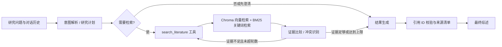

# 文献研究智能 Agent

面向科研人员的本地文献综述 Agent，支持导入 PDF/Markdown 文献并构建 Chroma 知识库。基于 LangGraph 编排研究流程，结合向量检索与 BM25 混合召回证据，比较多篇文献观点并生成带可核验来源的中文综述；支持 OpenAI API 及兼容服务。

> `demo_papers/` 中的两篇 PDF 是为演示解析、检索和引用流程而编写的**虚构样例**，不是可引用的真实研究论文。

## 环境

- Python 3.10 或更新版本
- 可访问的 OpenAI API 或 OpenAI-compatible 模型服务，以及对应 API Key
- 首次使用时可下载 Sentence-Transformers 多语言 embedding 模型；向量计算默认在 CPU 上进行

## 安装

PowerShell：

```powershell
cd D:\实习项目二
python -m venv .venv
.\.venv\Scripts\Activate.ps1
python -m pip install --upgrade pip
pip install -e .
Copy-Item .env.example .env
```

可选：如需单独管理依赖，也可用 `pip install -r requirements.txt`，随后执行 `pip install -e . --no-deps` 安装项目包。在 `.env` 中填写 `OPENAI_API_KEY`。若使用兼容服务，同时设置 `OPENAI_BASE_URL` 和该服务支持的 `OPENAI_MODEL`。`.env` 已加入 `.gitignore`，不要提交密钥。

若要重新生成示例 PDF：

```powershell
python scripts\generate_demo_pdfs.py
```

## 快速运行

导入两篇演示文献：

```powershell
python -m lit_review_agent ingest demo_papers
```

一次性提问：

```powershell
python -m lit_review_agent ask "比较两篇演示研究对 RAG 检索效果的结论，并说明差异可能来自哪里"
```

限制来源或年份：

```powershell
python -m lit_review_agent ask "总结混合检索的证据" --from-year 2021 --to-year 2025
python -m lit_review_agent ask "某作者的主要结论" --source "Demo Research Group"
```

连续多轮对话：

```powershell
python -m lit_review_agent chat
```

在同一 `chat` 进程中保留会话记忆；`--session ID` 可指定 LangGraph thread ID。使用相同 ID 跨进程恢复需要替换当前的内存 checkpointer 为 SQLite/PostgreSQL checkpointer。

运行离线单元测试（不调用 LLM API、不下载 embedding 模型）：

```powershell
python -m unittest discover -s tests -v
```

## 架构



- **解析**：PyPDF 提取 PDF 文本；Markdown 直接读取。基于显式 `Title/Authors/Year/Abstract` 字段及 PDF 元信息提取基础元数据，再按可配置长度分块。
- **索引**：Sentence-Transformers 生成向量，Chroma 持久化；BM25 对本地文献全集做关键词召回，使用 Reciprocal Rank Fusion 合并排序。
- **Agent**：LangGraph 状态包括问题、计划、检索式、证据片段、分析日志、循环次数、答案和引用。`search_literature` 是具备 Pydantic 参数校验的 LangChain 工具。
- **记忆**：`MemorySaver` 按 `thread_id` 保存当前 Python 进程内的多轮状态；不是跨重启持久化记忆。
- **幻觉控制**：回答结构要求每条观点绑定检索片段 ID；代码拒绝无效引用，并在校验失败时降级为原文摘录。引用提供可核查出处，但不能替代人工阅读原论文。

## 边界情况

- 空知识库、检索无结果：明确告知没有可支持结论的证据，不编造综述。
- 扫描版 PDF：PyPDF 无法 OCR，解析会跳过并提示；需先使用 OCR 工具生成可搜索 PDF。
- 元数据缺失：作者显示为 `Unknown`，年份留空；支持显式字段的论文模板，不声称可可靠解析所有期刊版式。
- 观点冲突：并列呈现冲突及可能的样本、方法或范围差异，不自动认定某篇正确。
- 检索循环：最大轮数由 `MAX_SEARCH_ITERATIONS` 限定；重复查询或无可用改写时停止。
- API 或结构化输出异常：CLI 记录异常；答案生成/引用校验失败时回退到来源明确的片段摘要。

## 项目结构

```text
src/lit_review_agent/    Agent、图状态、检索、解析与 CLI
tests/                   离线自动化测试
demo_papers/             两篇虚构演示 PDF
scripts/                 演示 PDF 生成器
docs/                    面试项目难点与方案
.env.example             API 和运行参数模板
```

## 项目边界

这是可扩展的工程原型，不是系统综述认证工具。BM25 在当前本地文献全集上即时建立索引，适合演示和小型语料；大语料应改为预建倒排索引并增加检索评测、去重和 reranker。PDF 元数据提取以显式标签和 PDF 标题为主，生产场景可接入 GROBID 等学术解析服务。