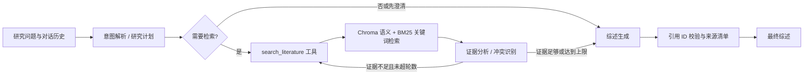

# 📚 Literature Review Agent｜文献综述智能助手

> 基于 **LangGraph** 与 **Chroma** 开发的科研文献综述 Agent：导入 PDF/Markdown 文献，本地构建知识库，自动生成带可核验引用的综述初稿。

<p align="center">
  
  
  
  
  
</p>

导入论文后，Agent 会解析文本、切片并写入 Chroma 向量库；随后用 LangGraph 编排「意图解析 → 混合检索 → 证据分析 → 综述生成」流程，提取文献观点、识别观点冲突，并给每一条结论绑定可核验的引用 ID，避免无来源推断。

> ⚠️ 项目内置 `demo_papers/` 两篇**虚构演示文献**，仅用于演示解析、检索与引用流程，不是可引用的真实论文。

---

## 📖 目录

- [✨ 功能特性](#-功能特性)
- [🧭 工作流程](#-工作流程)
- [🚀 快速开始](#-快速开始)
- [📖 使用说明](#-使用说明)
- [💬 示例](#-示例)
- [🧪 运行测试](#-运行测试)
- [📁 项目结构](#-项目结构)
- [🛠️ 技术栈](#-技术栈)

---

## ✨ 功能特性

- **多格式文献导入**：支持 PDF（PyPDF 提取文本）与 Markdown，自动识别 `Title/Authors/Year/Abstract` 元数据并按可配置长度切片。
- **混合检索**：Chroma 语义检索 + BM25 关键词检索，以 RRF（倒数排名融合）合并排序，兼顾改写表达与精确术语。
- **多 Agent 协同**：LangGraph 编排任务规划、检索、证据分析、综述生成等节点，证据不足时自动改写检索式继续检索。
- **引用可核验**：每条观点绑定检索片段 ID；引用校验失败时回退为带来源的原文摘录，不编造结论。
- **本地运行保障隐私**：向量库与 embedding 模型本地持久化，文献数据不出本机。

---

## 🧭 工作流程



---

## 🚀 快速开始

### 1. 准备环境

- Python 3.10 或更高版本。
- 一个可用的 OpenAI API 或 OpenAI 兼容模型服务，以及对应 API Key。

### 2. 安装

```bash
pip install -e .
```

### 3. 配置密钥

复制 `.env.example` 为 `.env` 并填写：

```bash
OPENAI_API_KEY=sk-...       # 使用 OpenAI
# OPENAI_BASE_URL=...        # 使用兼容服务时填写
# OPENAI_MODEL=...           # 使用兼容服务时填写
```

### 4. 导入文献

```bash
python -m lit_review_agent ingest demo_papers
```

### 5. 提问

```bash
python -m lit_review_agent ask "比较两篇演示研究对 RAG 检索效果的结论"
```

---

## 📖 使用说明

| 命令 | 说明 |
| --- | --- |
| `ingest <文件或目录>` | 解析 PDF/Markdown 文献，切片后写入 Chroma 向量库 |
| `ask "<问题>"` | 一次性生成带引用的综述 |
| `chat` | 进入多轮研究对话，输入 `exit` 退出 |

`ask` 与 `chat` 均支持按来源/年份过滤：

```bash
python -m lit_review_agent ask "总结混合检索的证据" --from-year 2021 --to-year 2025
python -m lit_review_agent ask "某作者的主要结论" --source "Demo Research Group"
```

---

## 💬 示例

```text
用户：比较两篇演示研究对 RAG 检索效果的结论，并说明差异可能来自哪里。

**文献观点与综合分析**
- [文献观点] 语义检索有助于处理查询改写与近义表达。[Cchunk0001abcdef]
- [综合推断] 两篇研究均认为混合检索优于单一检索，但样本规模不同。[Cchunk0001abcdef][Cchunk0002abcdef]

**观点差异**
- [观点冲突] 关于 BM25 的贡献，两篇研究的结论存在差异。[Cchunk0001abcdef][Cchunk0002abcdef]

**引用来源**
- [Cchunk0001abcdef] Demo Research Group, 2022. Hybrid Retrieval Demo. (demo_study_2022.pdf)
- [Cchunk0002abcdef] Demo Research Group, 2024. Retrieval Evaluation Revisited. (demo_study_2024.pdf)
```

---

## 🧪 运行测试

离线单元测试（不调用 LLM API、不下载 embedding 模型）：

```bash
python -m unittest discover -s tests -v
```

---

## 📁 项目结构

```
├── src/
│   └── lit_review_agent/   # Agent、图状态、检索、解析与 CLI
├── scripts/                # 演示 PDF 生成器
├── tests/                  # 离线自动化测试
├── demo_papers/            # 演示文献（PDF/Markdown）
├── requirements.txt        # Python 依赖
├── pyproject.toml          # 打包配置
├── .env.example            # API 与运行参数模板
├── .gitignore
└── README.md
```

---

## 🛠️ 技术栈

- **Python 3.10+**
- **LangGraph**（多 Agent 状态机编排）
- **LangChain**（工具调用 / 结构化输出）
- **Chroma**（本地向量库）
- **BM25**（关键词检索，rank-bm25）
- **Sentence-Transformers**（多语言 embedding）
- **PyPDF**（PDF 文本提取）
- **Pydantic**（参数与结构化输出校验）
